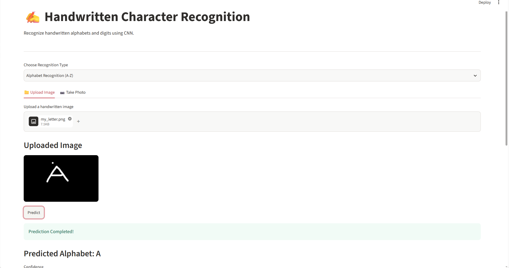
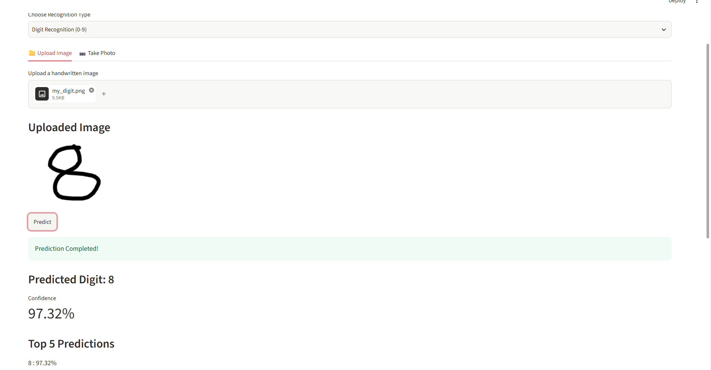
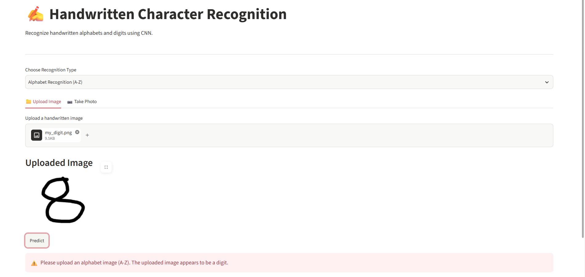

# ✍️ Handwritten Character Recognition

### CodeAlpha Machine Learning Internship – Task 1

## 📌 Project Overview

Handwritten Character Recognition is a Machine Learning project that finds alphabets from A to Z and digits from 0 to 9 in pictures that are uploaded or taken with a camera.

The project uses Convolutional Neural Networks built with TensorFlow to sort characters and show the predicted character and its confidence score.

## 🚀 Features

- Handwritten Character Recognition recognizes alphabets from A to Z.

- Handwritten Character Recognition recognizes handwritten digits from 0 to 9.

- Handwritten Character Recognition allows upload of handwritten images.

- Handwritten Character Recognition allows capture of handwritten images using a camera.

- Handwritten Character Recognition displays prediction results and confidence percentages.

- Handwritten Character Recognition shows the Top 5 predictions.

- Handwritten Character Recognition provides warnings when the uploaded image appears to be the wrong character type.

- Handwritten Character Recognition offers an interactive web interface using Streamlit.

## 🛠️ Technologies Used

- Python

- TensorFlow

- Keras

- NumPy

- Pillow (PIL)

- Streamlit

- Matplotlib

- TensorFlow Datasets

## 🧠 Machine Learning Models

Handwritten Character Recognition uses two Convolutional Neural Network models.

**1. Alphabet Recognition Model**

- Handwritten Character Recognition uses the EMNIST Letters dataset.

- Classes: A to Z.

- Architecture: CNN.

- Output: Predicted alphabet and confidence score.

**2. Digit Recognition Model**

- Handwritten Character Recognition uses the MNIST dataset.

- Classes: 0 to 9.

- Architecture: CNN.

- Output: Predicted digit and confidence score.

## 📂 Project Structure

```text

Handwritten_Character_Recognition/

│

├── app.py

├── main.py

├── alphabet_recognitio.py

├── predict_letter.py

├── handwritten_alphabet_model.keras

├── handwritten_digit_model.keras

├── requirements.txt

│

└── screenshots/

    --letter.png

    --digit.png

    --wrong prediction.png

```

## 📸 Screenshots

### Alphabet Recognition



### Digit Recognition



### Incorrect Recognition



## ⚙️ Installation and Execution

**Step 1: Clone the repository**

```bash

git clone https://github.com/charishmachowdarynunna-eng/CodeAlpha_Handwritten_Character_Recognition.git

```

**Step 2: Open the project folder**

```bash

cd CodeAlpha_Handwritten_Character_Recognition

```

**Step 3: Install the required libraries**

```bash

python -m pip install -r requirements.txt

```

**Step 4: Run the Streamlit application**

```bash

python -m streamlit run app.py

```

**Step 5:** Open the website that appears in your terminal.

Choose Alphabet Recognition or Digit Recognition upload an image or take a photo and click Predict.

## 🎥 Project Demonstration

A demonstration video showing the working application and its features is available here:

[Watch Project Demo](PASTE_YOUR_VIDEO_LINK_HERE)

##  Project Objective

The main objective of Handwritten Character Recognition is to create a system that uses deep learning to find handwritten alphabets and digits and to give an easy-to-use interface, for this task.

##  Internship

Developed as part of the **CodeAlpha Machine Learning Internship**.

---

 Thank you for visiting my project repository!